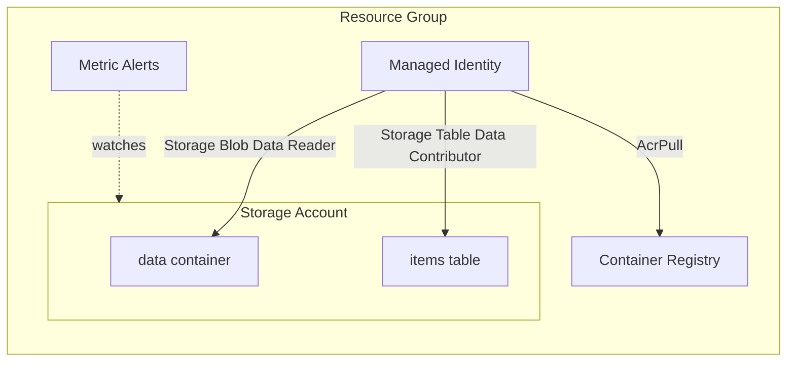

# Azure App Foundation Example

This is an example of how to use the [azure-app-foundation](/stacks/azure-app-foundation) stack. It provisions the
pieces an application needs before it can run, using services that cost little or nothing while idle:

- [azure-resource-group](/units/azure-resource-group) - Creates the resource group that holds everything else
- [azure-storage-account](/units/azure-storage-account) - Creates a storage account with a private `data` blob container
- [azure-storage-table](/units/azure-storage-table) - Creates an `items` table in the storage account
- [azure-container-registry](/units/azure-container-registry) - Creates a Basic container registry for the app's images
- [azure-managed-identity](/units/azure-managed-identity) - Creates the identity the app runs as, and grants it `AcrPull` on the registry plus `Storage Blob Data Reader` and `Storage Table Data Contributor` on the storage account
- [azure-monitor-alerts](/units/azure-monitor-alerts) - Alerts on the storage account's availability and latency. This unit is only created when `enable_alerts` is `true`.

## Usage

1. Log in to Azure with `az login`, select the subscription to deploy into with `az account set`, and export its ID:

   ```bash
   export ARM_SUBSCRIPTION_ID="$(az account show --query id --output tsv)"
   ```

2. Storage account and container registry names are unique across all of Azure. Pick a short prefix unique to you,
   using lowercase letters and digits only:

   ```bash
   export TG_AZURE_NAME_PREFIX=acme
   ```

3. Navigate to the example directory:

   ```bash
   cd examples/terragrunt/azure/stacks/azure-app-foundation
   ```

4. Deploy the stack. The first run creates the state storage account, so pass `--backend-bootstrap`:

   ```bash
   terragrunt stack run apply --backend-bootstrap
   ```

5. Look up the registry login server, the identity's client ID, and the rest of the outputs:

   ```bash
   terragrunt stack output
   ```

## Infrastructure Diagram



## Cleanup

When you're done testing, you can destroy the infrastructure:

```bash
terragrunt stack run destroy
```
