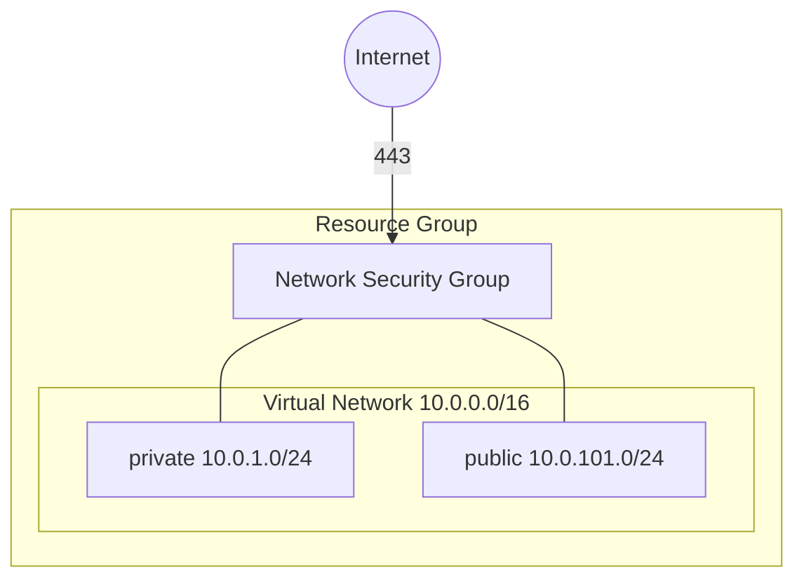

# Azure Network Example

This is an example of how to use the [azure-network](/stacks/azure-network) stack, which provisions the following units:

- [azure-resource-group](/units/azure-resource-group) - Creates the resource group that holds everything else
- [azure-vnet](/units/azure-vnet) - Creates a virtual network with a `private` and a `public` subnet
- [azure-nsg](/units/azure-nsg) - Creates a network security group and attaches it to both subnets
- [azure-nsg-rule](/units/azure-nsg-rule) - Allows inbound HTTPS from the internet, one unit per entry in `inbound_rules`

## Usage

1. Log in to Azure with `az login`, select the subscription to deploy into with `az account set`, and export its ID:

   ```bash
   export ARM_SUBSCRIPTION_ID="$(az account show --query id --output tsv)"
   ```

2. Navigate to the example directory:

   ```bash
   cd examples/terragrunt/azure/stacks/azure-network
   ```

3. Deploy the stack. The first run creates the state storage account, so pass `--backend-bootstrap`:

   ```bash
   terragrunt stack run apply --backend-bootstrap
   ```

4. Look up the IDs of what was created:

   ```bash
   terragrunt stack output
   ```

## Infrastructure Diagram



## Cleanup

When you're done testing, you can destroy the infrastructure:

```bash
terragrunt stack run destroy
```
