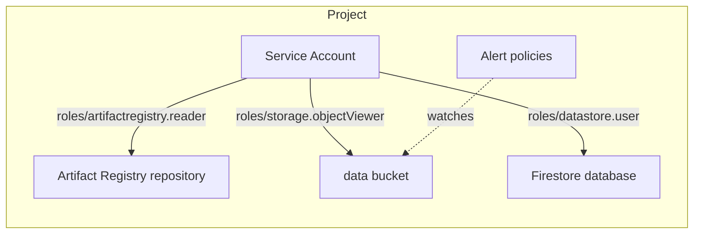

# GCP App Foundation Example

This is an example of how to use the [gcp/app-foundation](/stacks/gcp/app-foundation) stack. It provisions the
pieces an application needs before it can run:

- [gcp/storage-bucket](/units/gcp/storage-bucket) - Creates a private `data` bucket
- [gcp/firestore-database](/units/gcp/firestore-database) - Creates a Firestore database in Native mode
- [gcp/artifact-registry](/units/gcp/artifact-registry) - Creates a Docker repository for the app's images
- [gcp/service-account](/units/gcp/service-account) - Creates the service account the app runs as, and grants it `roles/artifactregistry.reader` on the repository, `roles/storage.objectViewer` on the bucket, and `roles/datastore.user` on the database
- [gcp/monitoring-alerts](/units/gcp/monitoring-alerts) - Alerts on the bucket's failed requests and egress. This unit is only created when `enable_alerts` is `true`.

## Usage

1. Log in to GCP with `gcloud auth application-default login`, select the project to deploy into with
   `gcloud config set project`, and export its ID:

   ```bash
   export GOOGLE_CLOUD_PROJECT="$(gcloud config get-value project)"
   ```

2. Enable the APIs the stack uses:

   ```bash
   gcloud services enable \
     artifactregistry.googleapis.com \
     cloudresourcemanager.googleapis.com \
     firestore.googleapis.com \
     iam.googleapis.com \
     monitoring.googleapis.com
   ```

3. Bucket names are unique across all of GCP. Pick a prefix unique to you, using at most 23 lowercase letters,
   digits and hyphens, starting with a letter:

   ```bash
   export TG_GCP_NAME_PREFIX=acme
   ```

4. Navigate to the example directory:

   ```bash
   cd examples/terragrunt/gcp/stacks/app-foundation
   ```

5. Deploy the stack. The first run creates the state bucket, so pass `--backend-bootstrap`:

   ```bash
   terragrunt stack run apply --backend-bootstrap
   ```

6. Look up the repository URI, the service account's email, and the rest of the outputs:

   ```bash
   terragrunt stack output
   ```

## Infrastructure Diagram



## Cleanup

When you're done testing, you can destroy the infrastructure:

```bash
terragrunt stack run destroy
```
