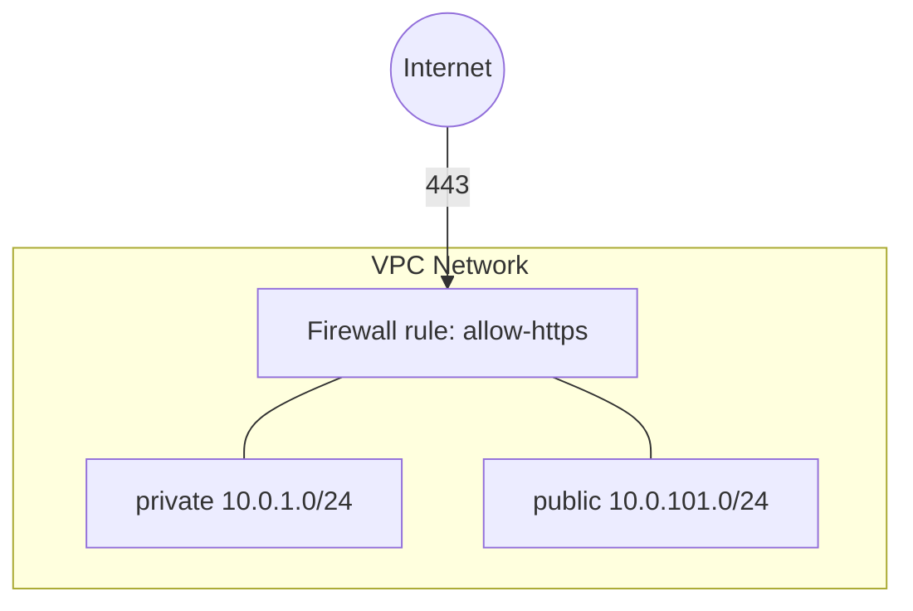

# GCP Network Example

This is an example of how to use the [gcp/network](/stacks/gcp/network) stack, which provisions the following units:

- [gcp/vpc](/units/gcp/vpc) - Creates a VPC network with a `private` and a `public` subnet
- [gcp/firewall-rule](/units/gcp/firewall-rule) - Allows inbound HTTPS from the internet to instances tagged `https-server`, one unit per entry in `inbound_rules`

## Usage

1. Log in to GCP with `gcloud auth application-default login`, select the project to deploy into with
   `gcloud config set project`, and export its ID:

   ```bash
   export GOOGLE_CLOUD_PROJECT="$(gcloud config get-value project)"
   ```

2. Enable the Compute Engine API, which manages networks:

   ```bash
   gcloud services enable compute.googleapis.com
   ```

3. Navigate to the example directory:

   ```bash
   cd examples/terragrunt/gcp/stacks/network
   ```

4. Deploy the stack. The first run creates the state bucket, so pass `--backend-bootstrap`:

   ```bash
   terragrunt stack run apply --backend-bootstrap
   ```

5. Look up the IDs of what was created:

   ```bash
   terragrunt stack output
   ```

## Infrastructure Diagram



## Cleanup

When you're done testing, you can destroy the infrastructure:

```bash
terragrunt stack run destroy
```
