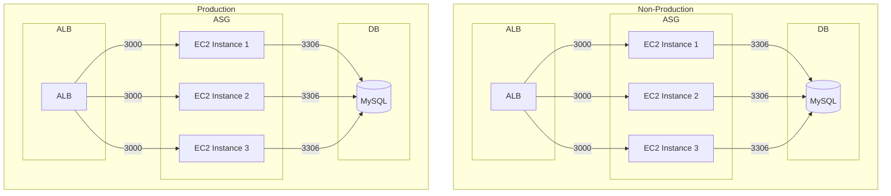

# Multi-Environment Stateful ASG Services Example

This example demonstrates how to deploy stateful web services using EC2 Auto Scaling Groups (ASG) with an Application Load Balancer (ALB) in AWS across multiple environments. The services run on Amazon Linux 2023 and automatically scale based on demand while maintaining state through a MySQL database.

## Usage

To deploy this example:

1. Navigate to the example directory:

   ```bash
   cd examples/terragrunt/stacks/multi-env-stateful-asg-services
   ```

2. Run the following command to deploy the service:

   ```bash
   terragrunt stack run apply
   ```

3. After deployment, you can access the service through the ALB's DNS name, which will be shown in the output.

   ```bash
   terragrunt stack output
   ```

   Each environment is keyed by its name, so you can read a single value by its address:

   ```bash
   terragrunt stack output -raw 'environment["prod"].service.url'
   ```

## Architecture

The example deploys two environments (`non-prod` and `prod`), each with:

- An EC2 Auto Scaling Group with Amazon Linux 2023 instances
- An Application Load Balancer to distribute traffic
- A MySQL database for persistent storage
- Security groups for the ALB, ASG, and database
- IAM roles and policies for the EC2 instances
- Security group rules controlling access between ASG and MySQL

## Configuration

The `terragrunt.stack.hcl` file declares one `stack` block and expands it with `for_each` over `local.environments`, generating one copy of the [ec2-asg-stateful-service](/stacks/ec2-asg-stateful-service) stack per key:

```hcl
stack "environment" {
  expansion {
    for_each = local.environments
  }

  source = "../../../..//stacks/ec2-asg-stateful-service"
  path   = each.key

  values = {
    name     = "multi-env-asg-${each.key}"
    min_size = each.value.min_size
    # ...
  }
}
```

Each environment sets the following:

| Field               | Description                                    | `non-prod` | `prod` |
|---------------------|------------------------------------------------|------------|--------|
| `min_size`          | Minimum number of instances in the ASG         | `2`        | `3`    |
| `max_size`          | Maximum number of instances in the ASG         | `3`        | `5`    |
| `allocated_storage` | Storage for the MySQL database, in GB          | `50`       | `100`  |
| `enable_alarms`     | Whether to create CloudWatch alarms on the ALB | `false`    | `true` |

Everything else (instance types, ports, database engine settings) is the same in both environments and set directly in the `values` map.

`enable_alarms` sets the `enabled` attribute on the stack's optional `alarms` unit. Prod generates it, with alarms on ALB 5XX errors and unhealthy hosts that notify an SNS topic. Non-prod doesn't generate the unit at all. Subscribe to the topic to receive the notifications:

```bash
terragrunt stack output -raw 'environment["prod"].alarms.sns_topic_arn'
```

## Implementation Details

The service runs on Amazon Linux 2023 (ARM64) and maintains state through a MySQL database. The configuration is provided through a user data script that:

1. Sets up a Bun application.
2. Configures the application to connect to the MySQL database.
3. Starts the application service.

## Infrastructure Diagram



Components (per environment):

- Application Load Balancer (ALB) listening on port 80 and forwarding traffic to the ASG on port 3000
- EC2 Auto Scaling Group (ASG) with multiple instances running the application
- MySQL database (DB) for persistent storage
- Security group rules controlling access between ASG and MySQL on port 3306
- IAM roles and policies for the EC2 instances
- In prod only, CloudWatch alarms on the ALB and an SNS topic for their notifications

## Environment Management

This example supports multiple environments (`non-prod` and `prod`) via re-usable stacks. To add an environment, add a key to `local.environments`. Terragrunt generates it at `.terragrunt-stack/<key>`, and the existing environments keep their paths and state.

Removing a key stops Terragrunt from generating that environment, but leaves its infrastructure deployed. Destroy the environment before you remove its key:

```bash
terragrunt run --all --filter './.terragrunt-stack/prod/**' -- destroy
```

Then regenerate with `--source-update` to clear its directory out of `.terragrunt-stack`.

Each environment can have its own:

- Resource naming conventions
- Instance types and sizes
- Scaling policies
- Database configurations
- Optional components, such as alarms

## Cleanup

When you're done testing, you can destroy the infrastructure:

```bash
terragrunt stack run destroy
```
