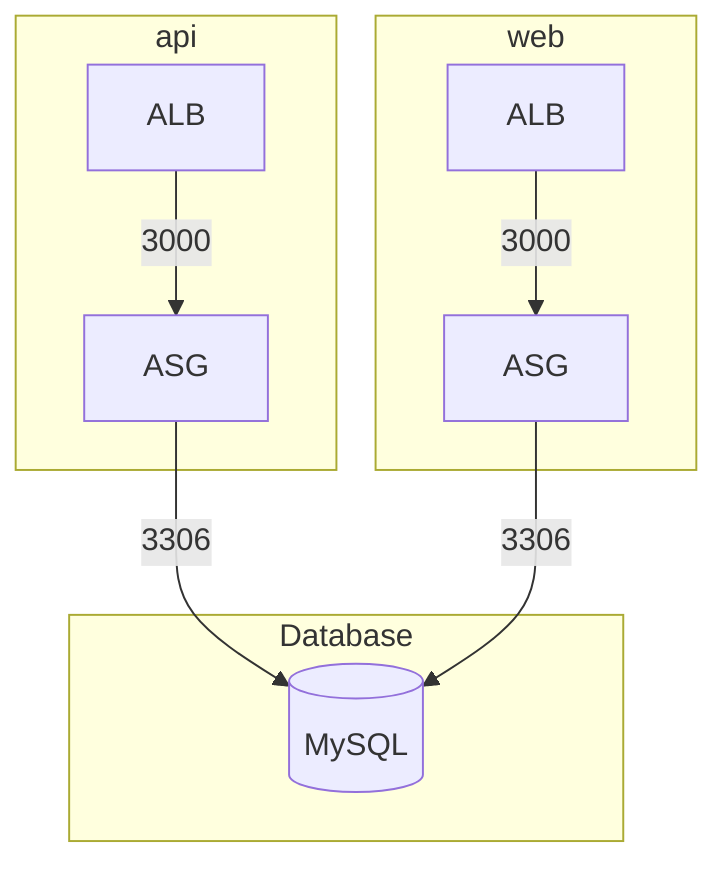

# Shared Database ASG Services Example

This example deploys several EC2 Auto Scaling Group (ASG) services that share one MySQL database. It uses `for_each` to generate one set of units per service from a single map, using the following units:

- [mysql](/units/mysql) - Sets up the MySQL RDS instance every service shares
- [sg](/units/sg) - Creates a security group for each service's instances
- [sg-to-db-sg-rule](/units/sg-to-db-sg-rule) - Lets each service's security group reach MySQL
- [ec2-asg-stateful-service](/units/ec2-asg-stateful-service) - Deploys each service as an ASG behind its own ALB

## Usage

1. Navigate to the example directory:

   ```bash
   cd examples/terragrunt/stacks/shared-db-asg-services
   ```

2. Run the following command to deploy the services:

   ```bash
   terragrunt stack run apply
   ```

3. After deployment, read each service's URL from the stack output. Each service is keyed by its name:

   ```bash
   terragrunt stack output -raw 'service["api"].url'
   terragrunt stack output -raw 'service["web"].url'
   ```

## Configuration

`local.services` lists the services to deploy:

```hcl
services = {
  api = {
    min_size = 2
    max_size = 4
  }

  web = {
    min_size = 1
    max_size = 2
  }
}
```

The `service`, `asg_sg` and `sg_to_db_sg_rule` units each expand over that map with an `expansion` block, so every key produces three units:

| Unit                        | Generated at                                  |
|-----------------------------|-----------------------------------------------|
| `service["<key>"]`          | `.terragrunt-stack/services/<key>`            |
| `asg_sg["<key>"]`           | `.terragrunt-stack/sgs/<key>`                 |
| `sg_to_db_sg_rule["<key>"]` | `.terragrunt-stack/rules/<key>-to-db-sg-rule` |

The `db` unit has no `expansion` block, so the stack generates it once.

Inside an expanded unit, `each.key` names the element being generated. The `autoinclude` blocks use it to pair each service with its own security group:

```hcl
unit "service" {
  expansion {
    for_each = local.services
  }

  # ...

  autoinclude {
    dependency "asg_sg" {
      config_path = unit.asg_sg[each.key].path
    }

    dependency "db" {
      config_path = unit.db.path
    }
  }
}
```

To add a service, add a key to `local.services`. The existing services keep their paths and state.

Removing a key stops Terragrunt from generating that service's units, but leaves its infrastructure deployed. Destroy them before you remove the key, selecting them by their generated paths:

```bash
terragrunt run --all \
  --filter './.terragrunt-stack/services/web' \
  --filter './.terragrunt-stack/rules/web-to-db-sg-rule' \
  --filter './.terragrunt-stack/sgs/web' \
  -- destroy
```

Then regenerate with `--source-update` to clear their directories out of `.terragrunt-stack`.

## Infrastructure Diagram



## Components

### Services

Each service gets its own ALB listening on port 80, and its own ASG running the same Bun application as the [stateful-asg-service](/examples/terragrunt/stacks/stateful-asg-service) example. Both services serve the same movie data:

- `GET /` - Health check
- `GET /movies` - List all movies
- `GET /movies/:id` - Get movie by ID

Every instance runs the migration and seed on boot. Both are idempotent, so instances from different services can start at the same time without conflict.

### Database

- One MySQL RDS instance for every service
- One security group rule per service allows its instances to reach MySQL on port 3306

## Cleanup

When you're done testing, you can destroy the infrastructure:

```bash
terragrunt stack run destroy
```
